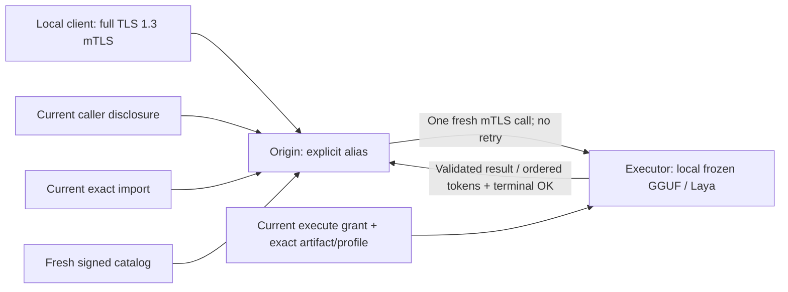

# Opt-in single-hop runtime

Federation is disabled unless `MDMA_FEDERATION_CONFIG` selects a reviewed local
runtime configuration and an existing, correctly bound trust store. Creating
that file does not enroll peers or approve any model/caller permissions.



## Independent switches

The existing runtime TLS/signing/issuer/listener fields remain mandatory.
These workload fields all default to off/empty:

```toml
poll_catalogs = true
enable_execution = false
enable_routing = true

[[routes]]
alias = "reviewed-remote-model"
peer_id = "executor.example.test"
model = "explicit-export-name"
artifact_id = "sha256:<64 reviewed lowercase hex digits>"
profile_id = "sha256:<64 reviewed lowercase hex digits>"
operation = "synthesize" # or "decide"
```

Replace placeholder digests with actual catalog identities. URLs, empty/default
model names, wildcards, failover lists and local-model-shadowing aliases are
invalid. A route is pinned to exactly one executor/artifact/profile/operation.
Use the alias in the ordinary client RPC's `model` field. Routing aliases are
operator configured. `Introspect` includes aliases only for an actually
authenticated caller with current disclosure/import consent and a fresh exact
ready catalog. It reveals no executor URL and reserves no execution resources.

On the executor, separately set `enable_execution = true` and approve the
origin peer's exact `execute_exports`. The origin requires polling, an exact
`route_imports` grant and local `Store::approve_disclosure(Disclosure)` consent
for the actual client SPKI, peer, remote model, operation and finite window.
Removing consent or imports cancels work. Catalog, execution, import and caller
disclosure permissions are independent. No new flag creates a grant.

Use the native `mdma-serve` path, which freezes consumed model artifacts, warms up,
captures actual profiles and attaches the native controller. Control-only mode
cannot activate execution/routing. CPU GGUF, native Metal/ROCm/Vulkan GGUF and
CPU Laya are supported. GPU decoders require a current concrete-backend
[GPU execution profile](execution-profile-gpu-v1.md); CUDA/Level Zero remain
unprofiled. GPU-enabled builds still serve Laya on CPU.

## Client authentication and deadlines

Ordinary local/default/upstream RPCs retain their existing semantics. Routed
calls require an actual **full TLS 1.3, HTTP/2, authenticated-client handshake**
and one positive `grpc-timeout`, captured before protobuf decoding. Normal
client certificates need no federation URI identity. HTTP headers and claimed
caller IDs cannot create a principal.

TLS1.2, anonymous or resumed local connections cannot route. The MDMA mTLS
client helper disables resumption; custom clients must do likewise. Client
issuers remain separate from federation issuers and server keys.

The origin subtracts routing, dialing and negotiation time, caps execution at
300 seconds and additionally bounds it by actual caller/consent and peer
credential lifetimes. It never resets the received deadline or redispatches
after a failure, even before `Accepted`. Failed transport outcomes are ambiguous.

The `mdma-client` binary accepts `MDMA_RPC_TIMEOUT_MS=30000` (1..300000) for both
workload operations. Set it together with `MDMA_MODEL=<approved-alias>` for
routing. Leaving it unset preserves ordinary local calls without a deadline.

## Bounded lifetime and output

The origin permits one active/undrained routed response, eight client
connections and two concurrent decoders without a waiting queue. The existing
ordinary protobuf message size bound remains in force; the route validates
the advertised 64KiB input cap before dialing. Remote token messages are capped
at 64KiB, with one event in the origin handoff. There is no output collector.

An independent supervisor checks fixed deadlines, shutdown and current trust/
consent while a client is not polling. Dropping/resetting the client call drops
the owned remote connection. Quota remains charged through RPC/body lifetime.
Authorization is checked again before queued token and encoded frame release.
Already handed-off/in-flight transport bytes cannot be recalled.

The origin sends all resolved sampler fields explicitly, including preserved
zero values, so another executor build cannot silently supply different defaults.

Synthesis success requires validated `Accepted → Token* → Completed → gRPC OK`.
The origin checks the selected identity/request ID, resolved sampler/caps,
contiguous token indexes, output limits, completion count/reason and final
status. Missing/extra/corrupt events fail; partial output remains a failure and
is never supplemented from another executor. Unary decisions validate identity,
result size and typed question/result schema, including duplicate keys.

## Operations and acceptance

Trust APIs publish atomically, persist before success and notify running
controllers. A running store has one locked writer; never edit its JSON or
unlink either trust or machine lock. There is not yet a public live-admin CLI.
For standalone operator changes, stop **your own** server, use the Store APIs,
then restart with the same reviewed configuration; lost/corrupt trust must not
be recreated automatically. Generation changes conservatively cancel in-flight
routes, including otherwise unrelated policy edits.

Conformance includes actual two-leg HTTP/2 mTLS loopback inference, native
synthesis/Laya parity, resumption rejection, deadlines/reset/drop/revocation,
response quotas and malicious executor output/no-redispatch tests.

### Hardware acceptance

Development acceptance used independently enrolled ARM64/x86_64 macOS and
x86_64 Linux hosts, a real TinyLlama GGUF and the ordinary mTLS client:

| Executor | Checked |
|---|---|
| CPU (macOS ARM64 and x86_64) | Bidirectional verified catalogs, two-leg synthesis, typed decisions with a generated Laya checkpoint |
| Metal (Apple silicon) | Synthesis through an approved alias with validated terminal completion; eager and request-owned paths have separate checkpoint gates |
| Vulkan (Linux, discrete NVIDIA GPU) | Synthesis with exact pins; device/kernel checks, frozen-resource parity, mode-change withdrawal, checkpoint greedy/logprob parity |
| ROCm f32 reference (Linux, RDNA4) | Checkpoint greedy/logprob parity, serialized ROCm library suite, three-host delegation |

All runs rejected missing deadlines, wrong operations and unapproved caller
disclosure; unapproved callers could not see route aliases. GPU runs also
failed closed on wrong artifact/profile pins and completed independent work
after a dropped stream. Previously approved routes stayed usable alongside new
aliases. These are not production throughput benchmarks or fleet
certification, and CUDA/Level Zero federation remains unqualified.

### Deployment notes

For the ROCm reference-mode server, set `MDMA_BACKEND=rocm` and `MDMA_HIP_F32=1`.
`mdma-serve` validates the latter as `0` or `1` (default `0`) and freezes the selection
at startup. Reference mode uses GPU f32 activations/KV without WMMA/int8 or graph
execution; its numerical mode is part of the profile pin. The known fast ROCm
checkpoint drift remains unqualified: no tolerances were relaxed to enable it.

On macOS versions enforcing Local Network privacy, daemon permission is an
independent OS gate. A build
must have an identifiable app/code-signing identity and the operator must grant
the necessary permission. A reachable peer from an interactive test does not
prove daemon access. Do not disable OS policy or tunnel around a denial.
Diagnostics report only static failure stages and OS error kinds, not private
transport error text.

The real Laya checkpoint tested did **not** qualify: `tokenizers` 1.0.0-rc.2
requires all 256 ByteLevel atoms and rejects its vocabulary at byte `0xC0`.
No token IDs/checkpoint bytes were altered to bypass that error. The generated
decision fixture demonstrates transport/native execution, not real classifier
readiness. Validate actual checkpoint compatibility separately.

This is service-level request delegation, not GPU/RAM pooling, model transfer
or tensor/KV sharding. GPU execution is whole-request delegation to one
independently provisioned executor, not multi-GPU execution of one model.
